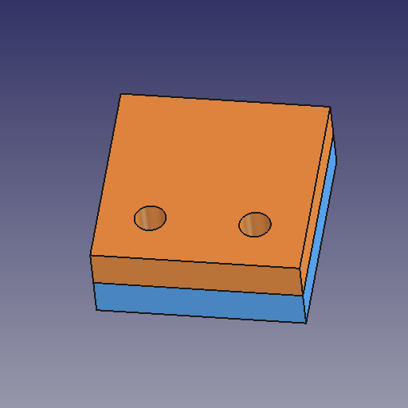
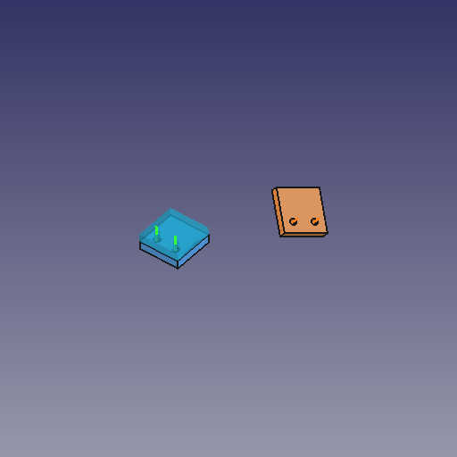

# FreeCAD MCP for meta-agent

FreeCAD MCP с измеряемым результатом сборки: агент получает геометрию крепления,
планирует перемещение, проверяет результат и видит несколько ракурсов.

Основан на [neka-nat/freecad-mcp](https://github.com/neka-nat/freecad-mcp)
(MIT). Сохранены все 17 исходных инструментов, аддон и история upstream.
Версия **0.2.1**: нативный аддон и MCP, **31 инструмент** (17 исходных + 14 новых).


 Исходная документация:
[UPSTREAM_README](UPSTREAM_README.md).

## Быстрый запуск

Требуются Python 3.12+, uv и открытый FreeCAD с запущенным MCP RPC на порту 9875.

```bash
uv sync
uv run freecad-mcp --host 127.0.0.1
```

Нужен **наш аддон 0.2.1**, а не только старый upstream-аддон. Сборочные операции
исполняются через отдельный нативный RPC API; Python-код для них не передаётся.
CAD-ядро имеет один исходник `addon/FreeCADMCP/freecad_mcp_core/` и также включено
в MCP wheel. `get_assembly_capabilities` проверяет независимый assembly-протокол.

Установка с резервной копией предыдущего аддона:

```bash
uv run python scripts/install_addon.py --target /absolute/FreeCAD/user/Mod/FreeCADMCP
```

Обычная установка требует перезапуска FreeCAD. Если старый RPC уже работает,
добавьте `--activate`: установщик проверит отсутствие открытых транзакций и
фоновых работ, заменит обработчики в существующем сервере и проверит протокол.
Документы не закрываются. GUI-диспетчер и очередь сохраняются; обновление самого
диспетчера требует обычного перезапуска. Старый аддон сохраняется вне `Mod/`.
Для временной совместимости со старым аддоном есть явный `--allow-legacy-addon`;
в этом режиме доступны операции, доставляемые через `execute_code`, а нативные
jobs и их гарантии отсутствуют. По умолчанию автоматического fallback нет.

Для новой установки аддона см. [исходную инструкцию](UPSTREAM_README.md).
При включённой аутентификации задайте `FREECAD_MCP_TOKEN` в окружении MCP.

## Подключение к meta-agent

Добавьте custom MCP в нужное пространство, сохранив другие серверы:

```json
{
  "id": "freecad",
  "command": "/absolute/path/freecad-mcp/.venv/bin/freecad-mcp",
  "args": ["--host", "127.0.0.1"],
  "required": true,
  "toolTimeoutSec": 240,
  "roles": ["meta", "project"]
}
```

`toolTimeoutSec` поддерживается обновлённым meta-agent и попадает в Codex
`tool_timeout_sec`. После обновления кода meta-agent перезапустите его процесс;
после изменения MCP создайте новую агентную сессию. Для других MCP-клиентов
настройте таймаут вызова отдельно. При сетевом таймауте состояние операции
неизвестно: дождитесь освобождения GUI и проверьте `check_assembly`, прежде чем
снова перемещать деталь. Таймаут RPC не останавливает выполняющуюся CAD-операцию.

## Какие документы не сохранены

`get_document_status()` возвращает все открытые документы; `doc_name` выбирает
один по внутреннему имени. `list_documents(include_status=true)` даёт тот же
снимок; прежний вызов без аргументов сохраняет список имён.

- `modified` — флаг `Gui.Document.Modified`, соответствующий состоянию интерфейса.
- `saved_once` — сохранялся ли документ раньше (`App.Document.isSaved()`).
- `needs_recompute` — нужен ли пересчёт (`isTouched()`), отдельно от сохранения.
- `file_path`, `file_exists` — связанный файл и его наличие на диске.
- `needs_save` — true для нового, изменённого документа или отсутствующего файла;
  null, если состояние Modified не удалось получить для ранее сохранённого файла.

Отсутствие GUI-состояния никогда не трактуется как «сохранён». Новый пустой
документ может иметь modified=false, но needs_save=true. App.save()/saveAs()
может оставить GUI Modified=true; инструмент честно сообщает флаг интерфейса.
GUI-сохранение сбрасывает его. Чтение статуса не сохраняет и не пересчитывает
документ. Проверяйте статус перед закрытием или reload документа.

## Задания и отмена

Все нативные операции ставятся в GUI-очередь как задания. Обычный инструмент
ждёт до 20 секунд, затем возвращает `job_id` для `get_assembly_job`, вместо
продолжения ожидания до таймаута клиента. Задание живёт в аддоне, независимо от
MCP-процесса. Перезапуск FreeCAD или активация нового аддона сбрасывает историю. Для важных долгих операций используйте явный протокол:

```text
start_assembly_operation("apply_alignment", {"plan_id": "..."}, request_id="mount-story-42")
get_assembly_job(job_id)
cancel_assembly_job(job_id)
```

Повтор того же `request_id` и аргументов возвращает тот же job; другие аргументы
отклоняются. Гарантия действует в пределах истории: 32 завершённых задания + все
активные, не более 8 ожидающих/выполняемых. Не повторяйте запрос после истечения
истории без проверки текущей геометрии. `outcome_unknown` означает, что GUI
превысил бюджет диспетчера: продолжайте опрашивать исходный job.

Отмена ожидающего job исключает выполнение; отмена уже работающего проверяется
между безопасными этапами. Для применения это вызывает откат транзакции. Сам
вызов OCCT не прерывается. После начала commit отмена отклоняется. accepted=true
означает принятую просьбу — дождитесь конечного состояния job.

## Рабочий цикл

1. `inspect_part(doc_name, part)` — валидность, габариты, плоские грани,
   цилиндры, оси и радиусы в **мировых координатах**, в миллиметрах.
   Большие детали выдаются страницами по 100 граней каждого типа; следуйте полям next_*_offset.
2. `define_interface(doc_name, part, plane_face, hole_faces)` — явный интерфейс:
   контактная плоскость и не менее двух отверстий в заданном порядке.
3. `plan_alignment(fixed_interface, moving_interface, obstacles=[...])` —
   план без изменения документа. Порядок отверстий определяет соответствие;
   симметрию и назначение крепления агент должен разрешить явно.
4. `preview_alignment(plan_id)` — три PNG с голубой полупрозрачной деталью
   в предлагаемом положении и осями креплений; документ не меняется.
5. `apply_alignment(plan_id)` — транзакция, перемещение, recompute, измерения.
   Ошибка или нарушение допуска вызывает откат. Файл не сохраняется.
6. `check_assembly(plan_id)` — повторная независимая проверка текущего положения:
   ошибки отверстий, углы осей, зазор и объёмы пересечений.
7. `inspect_region(doc_name, parts=[...])` — PNG изометрии, сверху и справа
   одним ответом с отпечатками геометрии. Камера и видимость восстанавливаются.

Например, две пластинки с двумя отверстиями:

```text
fixed = define_interface("Fixture", "Base", "Face6", ["Face7", "Face8"])
moving = define_interface("Fixture", "Bracket", "Face5", ["Face7", "Face8"])
plan = plan_alignment(fixed.interface_id, moving.interface_id,
                      gap_mm=0, tolerance_mm=0.01, obstacles=["Motor"])
apply_alignment(plan.plan_id)
check_assembly(plan.plan_id)
inspect_region("Fixture", ["Base", "Bracket", "Motor"])
```

Имена граней в примере условные: их нужно получить через `inspect_part`.
Противоположные нормали плоскостей задают соприкосновение, положительный зазор
откладывается наружу фиксированной детали. Радиусы могут различаться для
зазорного крепления: совместимость крепежа по диаметрам остаётся отдельной задачей.



## Границы проверки

- `apply_alignment` позиционирует через Placement. Для постоянной связи есть
  `create_assembly` и `create_fixed_joint`: стандартный FreeCAD Fixed Joint +
  Grounded Joint, штатный solver, транзакция и проверка геометрии после решения.
  Обе детали должны быть прямыми членами пустой нативной Assembly без других
  joints. `create_assembly` принимает только корневые детали, сохраняя их положения.
  После перемещения в Assembly нужно заново определить интерфейсы и план.
  Коннекторы Fixed Joint сохраняют относительное положение и отвязаны от топологии:
  изменение геометрии не переопределяет крепление автоматически. Редактирование
  произвольных существующих сетей constraints пока не поддерживается.
  apply_alignment отказывается перемещать детали в Assembly с существующими joints,
  чтобы не нарушать их Placement-изменением.
- Для проверяемых изменений нужен включённый FreeCAD Undo. Сохранение файла
  остаётся явным действием; Fixed Joint сохраняется и решается после reopen.
- Проверены `Part::Feature`, детали во вложенном `App::Part` и произвольные повороты.
  Для PartDesign выбирайте сам Body как `part` (проверено live smoke). Применение к `App::Link` и
  перемещение контейнера `App::Part` пока запрещены.
- Поддерживаются полные цилиндрические внутренние стенки, открывающиеся на
  выбранную плоскость перпендикулярно ей. Частичные цилиндры, пазы и составные
  стенки требуют отдельного расширения. Кандидат цилиндра не равен доказанному
  сквозному отверстию.
- Коллизии проверяются **только** между перемещаемой геометрией, фиксированной
  деталью и явно перечисленными `obstacles`. Ответ всегда содержит область
  проверки и `whole_assembly_checked: false`.
- Интерфейсы привязаны к отпечатку геометрии и положения. После изменений нужно
  определить их заново. Аддон наблюдает изменения документа; план устаревает при
  структурных изменениях, а close/reopen всегда меняет идентичность документа.
  Видимость и служебный _GroupTouched не считаются изменением геометрии. Идентификаторы живут в FreeCAD: истекают при перезапуске,
  обновлении runtime или вытеснении из кэша (256 записей каждого типа).
- Успешный скрипт и красивый скриншот не доказывают правильность сборки.
  Агент должен сообщить численный результат и область проверки.

## Проверка разработки

```bash
uv run pytest -q
uv run python -m compileall -q src addon
uv build
# Отдельный live smoke с открытым FreeCAD / RPC:
uv run python scripts/smoke_mounting.py --native
uv run python scripts/smoke_mounting.py --native --body --assembly
```

Live smoke создаёт и закрывает только одноразовый документ: два крепления,
поворот детали, вложенное размещение, препятствие для проверки отката, контроль
повторного применения и устаревших интерфейсов, три PNG. Нативный режим проверяет
откат после отмены, ghost preview, а --assembly также штатное решение Fixed Joint
после смещения и после сохранения/повторного открытия FCStd. Рабочие детали не меняет.
