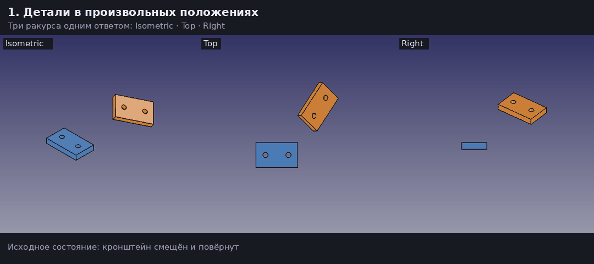

# FreeCAD MCP: сборка с проверкой результата

Fork [neka-nat/freecad-mcp](https://github.com/neka-nat/freecad-mcp) (MIT) для агентов,
которые собирают реальные механические узлы.

> **Upstream позволяет агенту сделать что-то в FreeCAD. Этот fork позволяет агенту
> доказать, что деталь встала правильно:** числами, а не фразой «скрипт выполнен».



## В чём разница

Возьмём типичную задачу: прикрутить кронштейн к основанию по двум отверстиям.

**В upstream** агент сам пишет Python: ищет грани, переводит координаты в мировые,
считает Placement, применяет его. Затем получает «скрипт выполнен» и один скриншот.
Если отверстия не совпали на 0,3 мм, это видно только на глаз.

```text
execute_code(<свой скрипт: найти грани → посчитать Placement → применить>)
→ "Script executed successfully"
get_view()  → одна картинка с одного ракурса
```

**В этом fork** то же самое — это готовые операции с измерениями и откатом:

```text
define_interface(основание)     define_interface(кронштейн)     # какая грань, какие отверстия
plan_alignment(...)             # план без изменения документа
preview_alignment(plan_id)      # голубая деталь в предлагаемом положении, 3 ракурса
apply_alignment(plan_id)        # перемещение в транзакции; при нарушении допуска — откат
check_assembly(plan_id)         # независимая повторная проверка
inspect_region(...)             # изометрия + сверху + справа одним ответом
```

Результат — измерения, а не «успех»:

```text
passed: true
max_hole_error_mm: 6.2e-14      hole_axis_angles_deg: [0.0, 0.0]
gap_mm: 3.6e-14                 opposing_faces_error_deg: 0.0
collisions: [{part: "Base", overlap_mm3: 0.0}]
collision_scope: ["Base"]       whole_assembly_checked: false
```

Это вывод реального запуска (FreeCAD 1.1.4, аддон 0.2.1): два бруска 40×24×6 мм с двумя
отверстиями, кронштейн изначально смещён и повёрнут. Значения порядка 1e-14 мм — шум
вычислений с плавающей точкой, то есть отверстия совпали точно. Анимация выше снята на
этой же сцене.

### Сравнение

Сравнение относится к **взятой за основу версии upstream 0.1.28**
([коммит 8babe992](https://github.com/neka-nat/freecad-mcp/commit/8babe9927ce8e6e8fe7dd6ae2ffa2c93776e845a));
с тех пор в upstream новых коммитов нет. Возможность написать собственный Python-код
сохранена, отличие fork — готовые операции с общими правилами проверки и ошибок.

| Задача | upstream | этот fork |
| --- | --- | --- |
| Количество инструментов | 17 | **32**: те же 17 + 14 инструментов сборки/статуса и конвертация STL в BREP |
| Найти геометрию крепления | Объекты, свойства и скрипты агента | `inspect_part`: плоскости, цилиндры, оси и радиусы в мировых координатах; `define_interface`: контактная грань и упорядоченные отверстия |
| Подготовить перемещение | Агент рассчитывает и задаёт Placement | `plan_alignment` проверяет соответствие отверстий без изменения документа; `preview_alignment` показывает положение и оси |
| Подтвердить результат | Успех скрипта и то, что агент отдельно запросил | Ошибки отверстий, углы осей, зазор и объёмы пересечения с указанными деталями |
| Неудачное совмещение | Транзакцию и откат нужно писать в скрипте | `apply_alignment` в транзакции, откат при нарушении допуска |
| Увидеть сборку | `get_view`: один ракурс за вызов | `inspect_region`: три ракурса одним ответом, камера и видимость восстанавливаются, учтён Tip у PartDesign Body |
| Долгая операция и таймаут | `execute_code_async` + `get_async_status` | Задания: `request_id` защищает от повторного запуска, отмена в безопасных точках, явный `outcome_unknown` |
| Не устарел ли план | Агент проверяет сам | Отпечатки геометрии, счётчик изменений, идентичность документа: устаревший план отклоняется |
| Закрепить связь деталей | Assembly API вручную через Python | `create_assembly` + `create_fixed_joint`: штатные Fixed/Grounded Joint, проверка после решения |
| Что не сохранено | `list_documents` возвращает имена | `get_document_status`: GUI-флаг изменений, наличие файла, сохранение и пересчёт раздельно |

### Что не изменилось

Все 17 исходных инструментов, аддон, headless-исполнение, FEM, история коммитов и
авторство upstream сохранены. Fork — надмножество: всё, что умел upstream, работает как раньше.
Новые операции требуют **нашего аддона 0.2.1**; со старым аддоном возможен лишь
ограниченный режим (см. [Быстрый запуск](#быстрый-запуск)). Документация upstream: [UPSTREAM_README](UPSTREAM_README.md).

### Что изменено в аддоне

Аддон работает внутри FreeCAD и выполняет то, что просит MCP-сервер. Новые инструменты
сборки возможны только благодаря ему: без аддона 0.2.1 они недоступны.

| Часть аддона | upstream 0.1.28 | этот fork |
| --- | --- | --- |
| Прежний RPC-код `rpc_server/` | Управление документами, объектами, скриптами, скриншотами | Почти не тронут (+45 строк): добавлены вызовы нового API и статус документов |
| `freecad_mcp_core/runtime.py` | Нет | Геометрия сборки: поиск граней и отверстий, расчёт перемещения, замеры, откат при нарушении допуска, предпросмотр, Fixed Joint |
| `freecad_mcp_core/jobs.py` | Нет | Очередь долгих операций: защита от повторного запуска по `request_id`, отмена в безопасных точках, статус `outcome_unknown` вместо ложной ошибки при зависшем GUI |
| `freecad_mcp_core/revisions.py` | Нет | Счётчик изменений документа: план отклоняется, если модель изменилась после его построения |
| `rpc_server/document_status.py` | Нет | Статус сохранения: GUI-флаг изменений, наличие файла, пересчёт |
| Установка | Копирование папки вручную | `scripts/install_addon.py`: установка с резервной копией прежнего аддона |

Раньше такую логику агент писал скриптом в каждом диалоге и мог ошибиться. Теперь это
готовый код внутри FreeCAD, который покрыт тестами и live smoke. Для рисования деталей,
FEM и обычных скриптов поведение аддона не изменилось. Проверки выполнены на наших
тестах и сценариях, а не на произвольных CAD-моделях.

### Когда достаточно upstream

Если вы рисуете детали, редактируете объекты, гоняете FEM или генерируете модели
скриптами, а не совмещаете готовые детали по крепёжным отверстиям, новые инструменты
вам не нужны: upstream проще и ставится быстрее. Fork нужен, когда важно
**проверяемо** состыковать детали и знать, что именно проверено.

## Зачем появился fork

Задача проекта — помогать агенту собирать реальные механические узлы для подставки
[androsaur-stand](https://github.com/androsaurs/androsaur-stand): совмещать крепёжные
отверстия основания и кронштейна с заданным зазором. Upstream дал рабочую основу:
управление FreeCAD, создание и редактирование объектов, скрипты, скриншоты, фоновые
задания, headless и FEM. В нашей работе проявились три ограничения.

1. **Успех скрипта не равен правильной сборке.** Агент сам писал код поиска граней,
   перевода координат и проверки; Python выполнялся, а детали оставались смещены.
   После правок снова требовались замеры и итерации.
2. **Один скриншот не подтверждает соосность.** По общей изометрии трудно увидеть
   совпадение отверстий, контакт плоскостей или малый зазор.
3. **Неясно, что после таймаута.** Можно ли повторить перемещение, актуален ли план,
   какие документы не сохранены — отдельные скрипты в каждом диалоге.

Цикл «план → предпросмотр → применение с откатом → измерение → несколько ракурсов»
делает условия успеха явными и даёт агенту данные для следующего решения. Он призван
сократить число исправлений на глаз; отдельного сравнительного измерения скорости или
числа итераций мы пока не проводили.

## Что подтверждено и где остаются ограничения

Версия **0.2.1**: 286 тестов проходят (проверено запуском `uv run pytest`), на MCP SDK
1.x и 2.x; CI также проверяет Python 3.12 и 3.13. Live smoke в FreeCAD проверяет
вложенные Placement, PartDesign Body, откат при коллизии и отмене, предпросмотр, а также
Fixed Joint после смещения и после сохранения и повторного открытия FCStd. Это
проверенные сценарии, а не гарантия для произвольной CAD-модели.

Что остаётся за агентом и за границами проверки:

- правильно выбрать контактные грани и порядок отверстий (симметрия не угадывается);
- коллизии проверяются только с фиксированной деталью и явно указанными `obstacles`;
  в ответе всегда `whole_assembly_checked: false`;
- нет поддержки `App::Link`, перемещения контейнеров `App::Part` и редактирования
  произвольных сетей Assembly-связей.

Полные условия: [«Границы проверки»](#границы-проверки).

## Автоматическая сшивка STL в BREP

`convert_mesh_to_brep` превращает STL-файл или объект сетки в отдельное твёрдое
BREP-тело и автоматически восстанавливает настоящие плоскости, цилиндры и
поддержанные частичные дуги. Это изменение геометрии, не визуальное сглаживание;
размеры определяются из STL без исходников OpenSCAD и ручного выбора граней.

Например, платформа наклона из 2884 треугольников восстановлена в **31 грань:
21 плоскость и 10 цилиндрических поверхностей**. Все шесть STL контрольного
набора проверены одним инструментом, включая сохранение и повторное открытие.

Исходник сохраняется, результат проверяется по валидности, объёму, габаритам и
остаточной гранёности. Опциональный ремонт ограничен численным допуском.
Параметрическая история не восстанавливается; неподдержанные поверхности могут
остаться гранёными. Файл автоматически не сохраняется.

**[Подробное руководство: STL → BREP](docs/mesh-to-brep.md)** — запуск, этапы
восстановления, результаты шести деталей, отчёт, проверки и ограничения.
[Параметры MCP-инструмента](docs/tools.md#mesh-to-brep-conversion).

## Быстрый запуск

Требуются Python 3.12+, uv и открытый FreeCAD с запущенным MCP RPC на порту 9875.

```bash
uv sync
uv run freecad-mcp --host 127.0.0.1
```

Нужен **наш аддон 0.2.1**, а не только старый upstream-аддон. Сборочные операции
исполняются через отдельный нативный RPC API; Python-код для них не передаётся.
CAD-ядро имеет один исходник `addon/FreeCADMCP/freecad_mcp_core/` и также включено
в MCP wheel. `get_assembly_capabilities` проверяет независимый assembly-протокол.

Установка с резервной копией предыдущего аддона:

```bash
uv run python scripts/install_addon.py --target /absolute/FreeCAD/user/Mod/FreeCADMCP
```

Обычная установка требует перезапуска FreeCAD. Если старый RPC уже работает,
добавьте `--activate`: установщик проверит отсутствие открытых транзакций и
фоновых работ, заменит обработчики в существующем сервере и проверит протокол.
Документы не закрываются. GUI-диспетчер и очередь сохраняются; обновление самого
диспетчера требует обычного перезапуска. Старый аддон сохраняется вне `Mod/`.
Для временной совместимости со старым аддоном есть явный `--allow-legacy-addon`;
в этом режиме доступны операции, доставляемые через `execute_code`, а нативные
jobs и их гарантии отсутствуют. По умолчанию автоматического fallback нет.

Для новой установки аддона см. [исходную инструкцию](UPSTREAM_README.md).
При включённой аутентификации задайте `FREECAD_MCP_TOKEN` в окружении MCP.

## Таймауты

Для долгих операций задайте в MCP-клиенте таймаут вызова не меньше 240 секунд. При
сетевом таймауте состояние операции неизвестно: дождитесь освобождения GUI и проверьте
`check_assembly`, прежде чем снова перемещать деталь. Таймаут RPC не останавливает
выполняющуюся CAD-операцию.

## Какие документы не сохранены

`get_document_status()` возвращает все открытые документы; `doc_name` выбирает
один по внутреннему имени. `list_documents(include_status=true)` даёт тот же
снимок; прежний вызов без аргументов сохраняет список имён.

- `modified` — флаг `Gui.Document.Modified`, соответствующий состоянию интерфейса.
- `saved_once` — сохранялся ли документ раньше (`App.Document.isSaved()`).
- `needs_recompute` — нужен ли пересчёт (`isTouched()`), отдельно от сохранения.
- `file_path`, `file_exists` — связанный файл и его наличие на диске.
- `needs_save` — true для нового, изменённого документа или отсутствующего файла;
  null, если состояние Modified не удалось получить для ранее сохранённого файла.

Отсутствие GUI-состояния никогда не трактуется как «сохранён». Новый пустой
документ может иметь modified=false, но needs_save=true. App.save()/saveAs()
может оставить GUI Modified=true; инструмент честно сообщает флаг интерфейса.
GUI-сохранение сбрасывает его. Чтение статуса не сохраняет и не пересчитывает
документ. Проверяйте статус перед закрытием или reload документа.

## Задания и отмена

Все нативные операции ставятся в GUI-очередь как задания. Обычный инструмент
ждёт до 20 секунд, затем возвращает `job_id` для `get_assembly_job`, вместо
продолжения ожидания до таймаута клиента. Задание живёт в аддоне, независимо от
MCP-процесса. Перезапуск FreeCAD или активация нового аддона сбрасывает историю. Для важных долгих операций используйте явный протокол:

```text
start_assembly_operation("apply_alignment", {"plan_id": "..."}, request_id="mount-story-42")
get_assembly_job(job_id)
cancel_assembly_job(job_id)
```

Повтор того же `request_id` и аргументов возвращает тот же job; другие аргументы
отклоняются. Гарантия действует в пределах истории: 32 завершённых задания + все
активные, не более 8 ожидающих/выполняемых. Не повторяйте запрос после истечения
истории без проверки текущей геометрии. `outcome_unknown` означает, что GUI
превысил бюджет диспетчера: продолжайте опрашивать исходный job.

Отмена ожидающего job исключает выполнение; отмена уже работающего проверяется
между безопасными этапами. Для применения это вызывает откат транзакции. Сам
вызов OCCT не прерывается. После начала commit отмена отклоняется. accepted=true
означает принятую просьбу — дождитесь конечного состояния job.

## Рабочий цикл

1. `inspect_part(doc_name, part)` — валидность, габариты, плоские грани,
   цилиндры, оси и радиусы в **мировых координатах**, в миллиметрах.
   Большие детали выдаются страницами по 100 граней каждого типа; следуйте полям next_*_offset.
2. `define_interface(doc_name, part, plane_face, hole_faces)` — явный интерфейс:
   контактная плоскость и не менее двух отверстий в заданном порядке.
3. `plan_alignment(fixed_interface, moving_interface, obstacles=[...])` —
   план без изменения документа. Порядок отверстий определяет соответствие;
   симметрию и назначение крепления агент должен разрешить явно.
4. `preview_alignment(plan_id)` — три PNG с голубой полупрозрачной деталью
   в предлагаемом положении и осями креплений; документ не меняется.
5. `apply_alignment(plan_id)` — транзакция, перемещение, recompute, измерения.
   Ошибка или нарушение допуска вызывает откат. Файл не сохраняется.
6. `check_assembly(plan_id)` — повторная независимая проверка текущего положения:
   ошибки отверстий, углы осей, зазор и объёмы пересечений.
7. `inspect_region(doc_name, parts=[...])` — PNG изометрии, сверху и справа
   одним ответом с отпечатками геометрии. Камера и видимость восстанавливаются.

Например, две пластинки с двумя отверстиями:

```text
fixed = define_interface("Fixture", "Base", "Face6", ["Face7", "Face8"])
moving = define_interface("Fixture", "Bracket", "Face5", ["Face7", "Face8"])
plan = plan_alignment(fixed.interface_id, moving.interface_id,
                      gap_mm=0, tolerance_mm=0.01, obstacles=["Motor"])
apply_alignment(plan.plan_id)
check_assembly(plan.plan_id)
inspect_region("Fixture", ["Base", "Bracket", "Motor"])
```

Имена граней в примере условные: их нужно получить через `inspect_part`.
Противоположные нормали плоскостей задают соприкосновение, положительный зазор
откладывается наружу фиксированной детали. Радиусы могут различаться для
зазорного крепления: совместимость крепежа по диаметрам остаётся отдельной задачей.


## Границы проверки

- `apply_alignment` позиционирует через Placement. Для постоянной связи есть
  `create_assembly` и `create_fixed_joint`: стандартный FreeCAD Fixed Joint +
  Grounded Joint, штатный solver, транзакция и проверка геометрии после решения.
  Обе детали должны быть прямыми членами пустой нативной Assembly без других
  joints. `create_assembly` принимает только корневые детали, сохраняя их положения.
  После перемещения в Assembly нужно заново определить интерфейсы и план.
  Коннекторы Fixed Joint сохраняют относительное положение и отвязаны от топологии:
  изменение геометрии не переопределяет крепление автоматически. Редактирование
  произвольных существующих сетей constraints пока не поддерживается.
  apply_alignment отказывается перемещать детали в Assembly с существующими joints,
  чтобы не нарушать их Placement-изменением.
- Для проверяемых изменений нужен включённый FreeCAD Undo. Сохранение файла
  остаётся явным действием; Fixed Joint сохраняется и решается после reopen.
- Проверены `Part::Feature`, детали во вложенном `App::Part` и произвольные повороты.
  Для PartDesign выбирайте сам Body как `part` (проверено live smoke). Применение к `App::Link` и
  перемещение контейнера `App::Part` пока запрещены.
- Поддерживаются полные цилиндрические внутренние стенки, открывающиеся на
  выбранную плоскость перпендикулярно ей. Частичные цилиндры, пазы и составные
  стенки требуют отдельного расширения. Кандидат цилиндра не равен доказанному
  сквозному отверстию.
- Коллизии проверяются **только** между перемещаемой геометрией, фиксированной
  деталью и явно перечисленными `obstacles`. Ответ всегда содержит область
  проверки и `whole_assembly_checked: false`.
- Интерфейсы привязаны к отпечатку геометрии и положения. После изменений нужно
  определить их заново. Аддон наблюдает изменения документа; план устаревает при
  структурных изменениях, а close/reopen всегда меняет идентичность документа.
  Видимость и служебный _GroupTouched не считаются изменением геометрии. Идентификаторы живут в FreeCAD: истекают при перезапуске,
  обновлении runtime или вытеснении из кэша (256 записей каждого типа).
- Успешный скрипт и красивый скриншот не доказывают правильность сборки.
  Агент должен сообщить численный результат и область проверки.

## Проверка разработки

```bash
uv run pytest -q
uv run python -m compileall -q src addon
uv build
# Отдельный live smoke с открытым FreeCAD / RPC:
uv run python scripts/smoke_mounting.py --native
uv run python scripts/smoke_mounting.py --native --body --assembly
```

Live smoke создаёт и закрывает только одноразовый документ: два крепления,
поворот детали, вложенное размещение, препятствие для проверки отката, контроль
повторного применения и устаревших интерфейсов, три PNG. Нативный режим проверяет
откат после отмены, ghost preview, а --assembly также штатное решение Fixed Joint
после смещения и после сохранения/повторного открытия FCStd. Рабочие детали не меняет.
